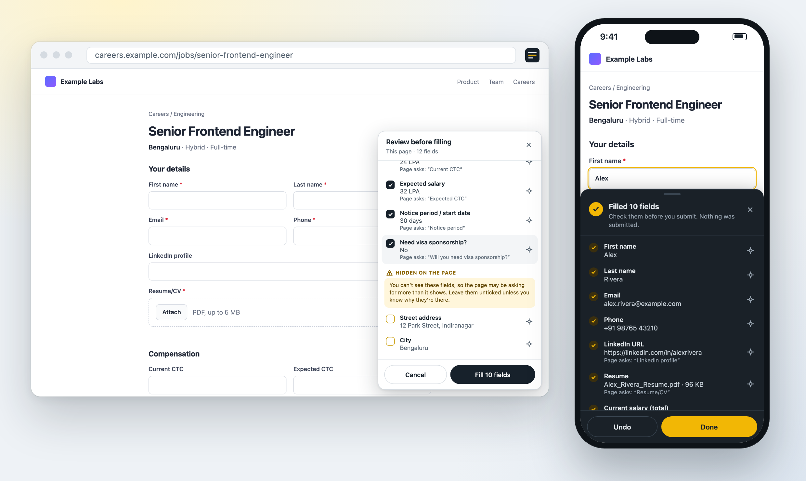
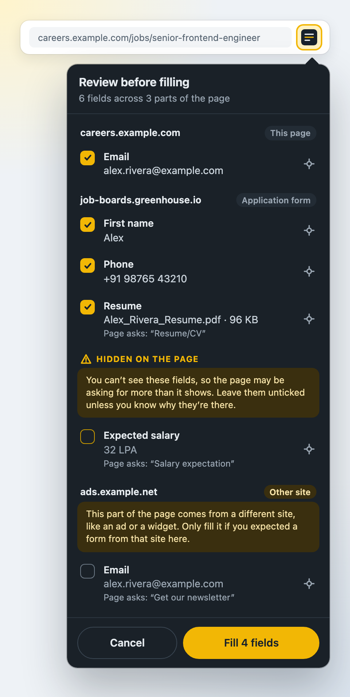

# Apply Kit

[](https://github.com/Larry8668/apply-kit/actions/workflows/lint.yml)
[](https://github.com/Larry8668/apply-kit/releases/latest)
[](LICENSE)

A Firefox extension that fills job applications from a profile you keep. You see every field and value before anything is filled. It works on Firefox for desktop and Android, and has no server, account or tracking of its own.

It's a personal project, built for one person's job search and shared in case it's useful. It isn't on the Firefox add-ons store. Signed builds are on the [releases page](https://github.com/Larry8668/apply-kit/releases/latest).

<p align="center">
  
</p>
<p align="center"><sub>Shown with a made-up profile on a test page.</sub></p>

## What it does



- **Review, then fill.** On pages that look like job applications (Greenhouse, Lever, Workday, Ashby, company career pages, and similar), a "Review N fields" button appears in the bottom-right corner. It opens a panel listing every field it would fill and the value it would use. Untick anything you don't want, tap the target icon to find a field on the page, then tap "Fill". Afterwards the panel shows what was filled, with Undo. Filled fields are highlighted in yellow. It never overwrites anything you've already typed, and it never submits the form.
- **Hidden fields stay empty unless you tick them.** Fields you can't see (tiny, transparent, off-screen, or clipped away) are listed separately under "Hidden on the page" and start unticked, so a page can't quietly collect more than it shows.
- **Resume.** Upload fields labelled resume or CV get your PDF, listed in the review panel like any other field. Add the PDF in settings, either by uploading it or from a link (Google Drive, Google Docs, Dropbox, or a direct PDF link). See [Resume](#resume).
- **Pay details.** Current total pay, fixed, variable and stock parts, a free-text breakdown, and expected salary are separate fields, so "Current CTC" and "Expected CTC" each get the right number.
- **Suggestions as you go.** When you tap into a field, a small box offers the matching profile value, plus up to three saved answers if the field is a longer question.
- **Saved answers.** After writing an answer to a question like "Why do you want to work here?", tap "Save as answer". Questions with similar wording on later forms get it as a suggestion.
- **Transfer code.** Firefox for Android can't sync extension data, so settings can turn your profile and saved answers into a one-line code to paste on your other device, optionally locked with a passphrase (settings can generate a strong one). See [Syncing between devices](#syncing-between-devices).
- **Searchable dropdowns.** Country, city and yes/no questions on Greenhouse's newer forms (and other sites using the same react-select widget) are picked from the site's own list. When several options match, such as cities called San Francisco, your state and country decide. Anything that can't be matched is listed under "Fill these by hand".
- **Applications.** Every form you fill is logged on that device with the company and role picked up from the page, the link, the date and which fields were filled. The Applications page (also one tap from the toolbar menu) has status tracking (Filled, Applied, Interviewing, Offer, Rejected, Withdrawn), filters, search and notes, and exports to Excel (.xlsx) or CSV. It can be turned off.
- **Extra fields.** For anything the profile doesn't cover, such as EEO questions or referral codes, add a name, some label keywords, and a value in settings.
- **Toolbar menu.** "Fill this page" works on any page, including ones not recognised as an application. It reviews every part of the page in one list, grouped by site. Forms embedded from known application platforms start ticked. Anything from an unrelated site, like an ad, is flagged "Other site" and starts unticked. "Edit profile" opens settings.

## Install

1. Download the `.xpi` file from the [latest release](https://github.com/Larry8668/apply-kit/releases/latest).
2. **Desktop Firefox:** open `about:addons`, click the gear icon, choose "Install Add-on From File…", and pick the `.xpi`.
3. **Firefox for Android:** go to Settings → About Firefox and tap the Firefox logo five times to unlock the debug menu. Go back to Settings, choose "Install extension from file", and pick the `.xpi`. These menu names have moved between Firefox versions, so search Mozilla's support pages if yours differs.
4. Click (or tap) the toolbar icon, choose "Edit profile", and fill in your details.

It updates itself from then on. See [Updates](#updates). Requires Firefox 115 or later on desktop, 120 or later on Android.

## Privacy and permissions

Everything you enter stays in your browser. Apply Kit has no server, no analytics and no tracking, and the manifest declares that it collects no data.

| Access | Why |
| --- | --- |
| `storage` | Keeps your profile, saved answers, resume and applications log in Firefox's extension storage. |
| Runs on every site | Needed to spot application forms wherever they're hosted, including company careers pages. To decide whether a page looks like an application, it checks the address and title, and on pages with an upload field, the start of the visible text. It reads form labels to match fields, and only writes into a form when you tap Fill or pick a suggestion. None of this is stored or sent anywhere. |
| Reach one site, on request (optional) | Only if you add a resume link. Firefox asks you first, and the permission covers just that link's site. Removing the resume gives it back. |

Your details only leave the browser in two ways: into the form fields you choose to fill, and, on desktop, through Firefox Sync, which encrypts them on your device first. The only other network requests are for updates: Firefox reads this repo's `updates.json` on GitHub about once a day, and the "Check for updates" button in settings reads the same file when you tap it. Neither sends any of your data. The code is plain JavaScript with no build step and no third-party code inside the extension, so it's quick to check yourself, starting in [`extension/`](extension).

## Try it without installing (temporary)

1. Open `about:debugging#/runtime/this-firefox`.
2. Click "Load Temporary Add-on…" and pick `extension/manifest.json`.

   Or, from the repo root: `npm install`, then `npm start`. That launches a fresh Firefox profile with the extension loaded and reloads it when files change.
3. Click the toolbar icon, choose "Edit profile", and fill in your details.

A temporary add-on is removed when Firefox restarts. To keep it, and to get it onto your phone, it needs to be signed.

## Syncing between devices

**Desktop to desktop:** sign in to the same Firefox account on each computer and make sure Add-ons is checked under Settings → Sync. Changes arrive within about 10 minutes, or right away with "Sync Now".

**To or from a phone:** Firefox for Android doesn't sync extension data with your Firefox account yet ([Mozilla bug 1625257](https://bugzilla.mozilla.org/show_bug.cgi?id=1625257)). Data saved on the phone stays on the phone, and desktop changes don't reach it. To copy your profile across, use a transfer code: in settings on one device, tap "Create transfer code" and "Copy code", send it to yourself (a notes app, email, or a chat with yourself), then paste it under "Paste a code from your other device" on the other and tap "Import code". The code holds your profile, extra fields and saved answers (not the resume), compressed into one line of text. Set a passphrase to lock it (AES-256-GCM, with the key derived from your passphrase); you'll need the same passphrase on the other device. Without one, the code isn't encrypted, so don't send it anywhere other people can read. "Export backup" and "Import backup" do the same with a file. Importing either one replaces everything on that device.

Sync storage is about 100 KB total, with 8 KB per saved answer (roughly 7,000 characters). That's plenty for a profile and dozens of answers. Settings shows how much you're using.

How it works: the profile, extra fields and saved answers live in the extension's `storage.sync` area. Each device keeps a copy inside its Firefox profile folder, so everything works offline. On desktop, when Firefox Sync runs, it uploads changes to Mozilla's sync servers and pulls down changes from your other devices. The data is encrypted on your device with a key derived from your Firefox account password before it's uploaded, so Mozilla stores it but can't read it. Apply Kit has no server of its own and sends nothing anywhere itself. If you're not signed in to Firefox Sync, the data just stays on that device. One catch: if you reset a forgotten Firefox account password, synced data can be wiped. Keep an exported backup.

## Resume

The PDF itself never goes into sync storage, because it's too big. Each device keeps its own copy in the extension's local storage. Only the file name, size, date and link (if any) go into sync storage. Between desktop computers, that lets settings on one say "Your other device has a newer resume."

- **Upload:** fully offline. Pick the PDF in settings on each device.
- **Link:** paste a share link and tap Download. Firefox asks for permission to reach that one site (for Google Drive, that's Google's download domains), and nothing is downloaded before you agree. Between desktop computers the link syncs, so on the other one it's a single tap on "Download it here", plus that computer's own permission prompt. On a phone, paste the link there too. The link must be viewable by anyone who has it. Removing the resume in settings also gives the site permission back.

Attaching works on forms with a real upload field, which covers Greenhouse, Lever, Ashby, Workday and most others. A few drag-and-drop-only upload areas don't have one; use their own upload button for those.

## Updates

The manifest's `update_url` points at [`updates.json`](updates.json) on `main`. Firefox checks it about once a day and installs any newer signed version listed there. The download is only accepted if its SHA-256 hash matches the one in `updates.json`. The "Sign and release" workflow adds each new release to that file automatically.

- **Desktop:** to check right away, open `about:addons`, click the gear icon, and choose "Check for Updates".
- **Which version am I on?** The toolbar menu shows it at the bottom, and settings has an Updates section with a "Check for updates" button that says whether a newer version is out. Firefox doesn't let an extension install updates itself, so that button only tells you.
- **Android:** Firefox for Android checks for add-on updates in the background on its own schedule.

Auto-updates start from version 0.3.0. Older versions don't have `update_url`, so 0.3.0 has to be installed by hand once.

## Building your own copy

Release versions of Firefox only install signed add-ons. Mozilla signs "unlisted" add-ons for free; they're signed but not listed on the add-on store.

If you fork this repo to sign your own build, change two things in `extension/manifest.json` first: the add-on `id` (Mozilla ties an id to one account) and `update_url` (point it at your fork's `updates.json`). Then:

1. Make an account at addons.mozilla.org and create API keys under Tools → Manage API Keys.
2. Sign it, either on GitHub or locally:
   - **GitHub:** add the keys as repo secrets `AMO_API_KEY` and `AMO_API_SECRET` (Settings → Secrets and variables → Actions). Then run the "Sign and release" workflow from the Actions tab, or push a version tag such as `v0.1.0`. The signed `.xpi` is attached to a GitHub release. The repo has to be public for auto-updates to work, since Firefox downloads `updates.json` and the `.xpi` without logging in.
   - **Locally:** see [Signing locally](#signing-locally).
3. Install the `.xpi` as described in [Install](#install).

Mozilla signs each version number only once. See [Releasing a new version](#releasing-a-new-version).

## Files

The extension lives in `extension/`. The repo root holds tooling only.

| File | Purpose |
| --- | --- |
| `extension/manifest.json` | Extension config. Uses Manifest V2, which Firefox fully supports and which grants site access at install, so there's no extra permission step on Android. |
| `extension/rules.js` | Profile fields and the patterns used to recognise them on forms. Edit this to add fields or tune matching. |
| `extension/storage.js` | Reads and writes extension storage: `storage.sync` for the profile and answers, `storage.local` for the resume PDF. |
| `extension/content.js` | Finds fields, fills them, and shows the suggestion box, the review panel and the fill button. |
| `extension/options.*` | Settings, split into pages: Profile, Saved answers, Resume, Applications, Backup & sync, About. `options.html#applications` opens a page directly. |
| `extension/xlsx.js` | Writes the Excel export. A few XML files in an uncompressed zip, no library. |
| `extension/popup.*` | Toolbar menu. |
| `updates.json` | Update manifest Firefox checks for new versions. Written by the release workflow. |
| `docs/screenshots/` | Images used in this README. |
| `package.json` | Dev scripts (see below). |
| `.github/workflows/` | Lint on every push and PR; sign and release on demand. |
| `.github/dependabot.yml` | Weekly update checks for `web-ext` and the GitHub Actions used in CI. |

## Development

Run `npm install` once, then from the repo root:

| Command | What it does |
| --- | --- |
| `npm run lint` | Checks the extension with Mozilla's linter, as a self-hosted add-on (so `update_url` is allowed). |
| `npm start` | Opens desktop Firefox with the extension loaded. |
| `npm run start:android -- --android-device=DEVICE_ID` | Runs it in Firefox on a USB-connected Android phone. Needs `adb` installed, USB debugging on in the phone's developer options, and "Remote debugging via USB" on in Firefox's settings. `adb devices` lists the device ID. If more than one Firefox build is installed, add `--firefox-apk=org.mozilla.firefox`. |
| `npm run sign` | Signs an unlisted `.xpi` into `web-ext-artifacts/`. Reads `WEB_EXT_API_KEY` and `WEB_EXT_API_SECRET` from the environment. |

## Signing locally

The keys can live in a `.env` file at the repo root. It's gitignored, so it never gets committed:

```
AMO_API_USER=user:12345:67
AMO_API_SECRET=your-64-character-secret
```

`npm run sign` doesn't read `.env` by itself. web-ext expects `WEB_EXT_API_KEY` and `WEB_EXT_API_SECRET`, so export them from the file first:

```
export WEB_EXT_API_KEY=$(grep ^AMO_API_USER= .env | cut -d= -f2-) WEB_EXT_API_SECRET=$(grep ^AMO_API_SECRET= .env | cut -d= -f2-)
npm run sign
```

The signed `.xpi` file appears in `web-ext-artifacts/`. The same two values are stored on GitHub as the repo secrets `AMO_API_KEY` and `AMO_API_SECRET`; if you rotate the keys, update both places.

## Releasing a new version

Mozilla signs each version number exactly once. Trying to sign a version that's already signed fails, so every release needs a new number.

1. Bump `version` in `extension/manifest.json` (for example `0.1.0` → `0.1.1`). Keep `version` in `package.json` matching, for tidiness.
2. Commit and push.
3. Tag and push the tag: `git tag v0.1.1 && git push origin v0.1.1`. The tag has to match the manifest version or the workflow stops. You can also run "Sign and release" from the Actions tab, which uses the manifest version as the tag.
4. The signed `.xpi` is attached to the new GitHub release, and the workflow commits the new entry to `updates.json`. Installed copies pick it up within a day. You can also install it by hand the same way as the first time; Firefox treats it as an update and keeps your data.

## Known limits and next steps

- **Drag-and-drop-only resume areas** with no real upload field behind them can't be filled; use the site's own upload button.
- **Workday dropdowns** use Workday's own widgets rather than react-select, so they still need a manual tap. How to handle them is worked out (open the prompt, match the option, confirm the selected value appears); it needs a live Workday application to test against.
- **Undo** clears most searchable dropdowns, but a few (like Greenhouse's city search) ignore being cleared by a script. Clear those by hand.
- **English labels only.** Matching is pattern-based and English-only. Adding patterns in other languages to `extension/rules.js` works.
- **Good next feature:** draft answers to new questions with an AI model, using your saved answers and the job description as context. This needs an API key and a small settings field for it.

## License

[MIT](LICENSE). Bug reports and ideas are welcome as [issues](https://github.com/Larry8668/apply-kit/issues). For security problems, see [SECURITY.md](SECURITY.md).
